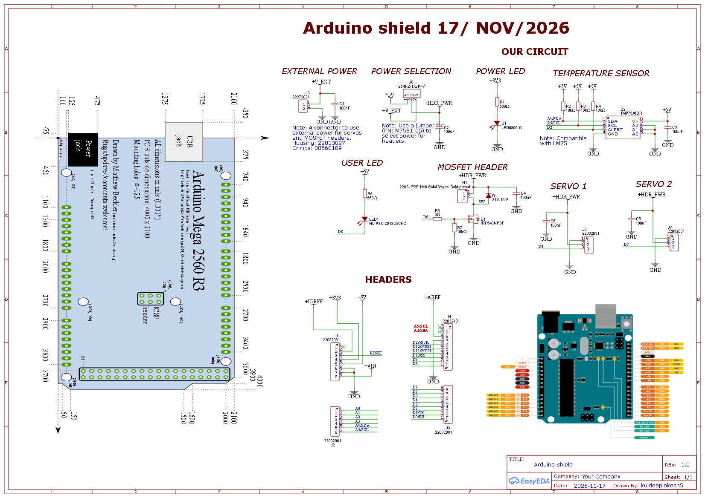
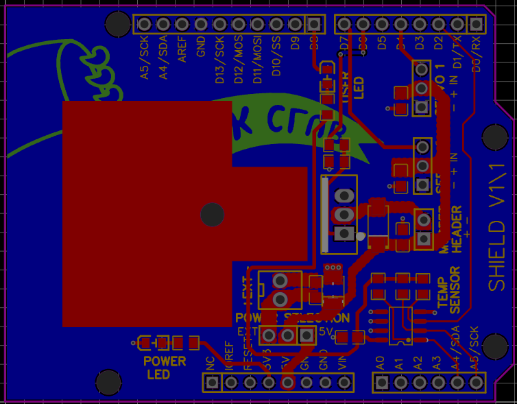

--->About the Project

This project is an Arduino Shield PCB designed using EasyEDA. It is an add-on board that can be connected to an Arduino board to make connections easier and add useful features.

The main purpose of this board is to provide easy power connections, servo connections, and access to different Arduino pins.

--->Features

- External power input
- Power selection circuit
- Power LED indicator
- Servo motor connection headers
- MOSFET connection header
- Digital and Analog pin connections
- Organized PCB layout
- Easy component connections

--->PCB schematic

--->3D PCB View

--->PCB Layout

--->Schematic

The schematic was designed in EasyEDA. It includes the power selection circuit, power LED, servo connections, MOSFET header, and other required connections.

--->Components Used

- Resistors
- Capacitors
- LEDs
- MOSFET
- Connectors and Pin Headers
- Power Input Connector
- Other required electronic components

--->Project Files

The project was designed using EasyEDA.

The schematic and PCB design are part of this project.

--->Manufacturing

The Gerber files inside the manufacturing folder can be uploaded to a PCB fabrication service for manufacturing.
Before ordering the PCB, verify the Gerber files, board dimensions, component footprints and BOM.

--->Source
The source folder contains the original EasyEDA project file, which can be imported into EasyEDA for editing.

--->How to Open the Project

1. Open EasyEDA.
2. Import the project files.
3. Open the schematic or PCB layout.
4. View and edit the design.

--->Tools Used

- EasyEDA – Schematic and PCB Design

--->PCB Video

https://cdn.hackclub.com/01a1fcd9-e60a-7501-a478-a6cb9d67ea8b/ardu.mp4

https://cdn.hackclub.com/01a1fcd9-e209-7cf5-a707-9c71e9b17a6a/ardui.mp4
