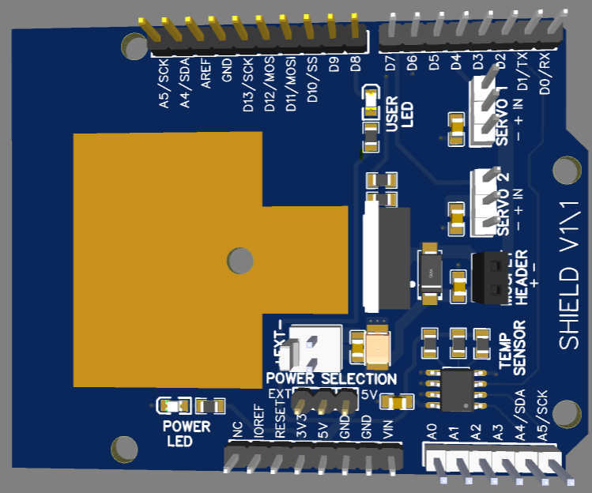

--->About the Project

This project is an Arduino Shield PCB designed using EasyEDA. It is an add-on board that can be connected to an Arduino board to make connections easier and add useful features.

The main purpose of this board is to provide easy power connections, servo connections, and access to different Arduino pins.

--->Features

- External power input
- Power selection circuit
- Power LED indicator
- Servo motor connection headers
- MOSFET connection header
- Digital and Analog pin connections
- Organized PCB layout
- Easy component connections

--->PCB Preview

--->3D PCB View

--->PCB Layout

--->Schematic

The schematic was designed in EasyEDA. It includes the power selection circuit, power LED, servo connections, MOSFET header, and other required connections.

--->Components Used

- Resistors
- Capacitors
- LEDs
- MOSFET
- Connectors and Pin Headers
- Power Input Connector
- Other required electronic components

--->Project Files

The project was designed using EasyEDA.

The schematic and PCB design are part of this project.

--->How to Open the Project

1. Open EasyEDA.
2. Import the project files.
3. Open the schematic or PCB layout.
4. View and edit the design.

--->Tools Used

- EasyEDA – Schematic and PCB Design

--->PCB Video

A video of the PCB design process is included in this project.

--->AI Usage

I designed this project myself. I used AI only a little to understand and solve some errors during the design process.

The main design work was done by me
